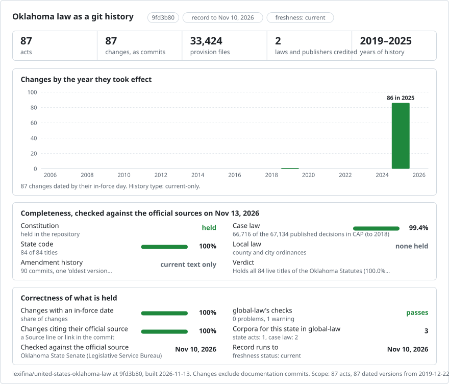

# Oklahoma: law history in git

<picture>
<source media="(prefers-color-scheme: dark)" srcset="data/effort-dark.svg">

</picture>

Part of [lexifina/global-law](https://github.com/lexifina/global-law), one git history for every country's law: this is the law of Oklahoma, United States, which global-law reads at `united-states/oklahoma/acts/`.

The Constitution of Oklahoma and the Oklahoma Statutes as a git repository: one file per section, one paragraph per line, so `git blame` works line by line. It follows the shared design of [lexifina/global-law](https://github.com/lexifina/global-law).

**What is in it now**

- `constitution/`: the Constitution of the State of Oklahoma, 404 sections, one version (the Oklahoma State Senate's PDF of December 2019).
- `title-NN/`: the Oklahoma Statutes, one folder per title (85 titles, 32,731 sections), and `title-74-appendix-1/`: Title 74's Appendix I, the Ethics Commission Rules (202 rules), one version each: the Legislature's edition of December 2025.

| Folder | Title | Sections |
| --- | --- | ---: |
| `title-01/` | Title 1: Abstracting | 24 |
| `title-02/` | Title 2: Agriculture | 1,054 |
| `title-03/` | Title 3: Aircraft and Airports | 172 |
| `title-03a/` | Title 3A: Amusements and Sports | 167 |
| `title-04/` | Title 4: Animals | 135 |
| `title-05/` | Title 5: Attorneys and State Bar | 16 |
| `title-06/` | Title 6: Banks and Trust Companies | 331 |
| `title-07/` | Title 7: Blind Persons | 14 |
| `title-08/` | Title 8: Cemeteries | 69 |
| `title-10/` | Title 10: Children | 381 |
| `title-10a/` | Title 10A: Children and Juvenile Code | 342 |
| `title-11/` | Title 11: Cities and Towns | 1,076 |
| `title-12/` | Title 12: Civil Procedure | 919 |
| `title-12a/` | Title 12A: Uniform Commercial Code | 672 |
| `title-13/` | Title 13: Common Carriers | 82 |
| `title-14/` | Title 14: Congressional and Legislative Districts | 18 |
| `title-14a/` | Title 14A: Consumer Credit Code | 243 |
| `title-15/` | Title 15: Contracts | 498 |
| `title-16/` | Title 16: Conveyances | 104 |
| `title-17/` | Title 17: Corporation Commission | 390 |
| `title-18/` | Title 18: Corporations | 718 |
| `title-19/` | Title 19: Counties and County Officers | 958 |
| `title-20/` | Title 20: Courts | 349 |
| `title-21/` | Title 21: Crimes and Punishments | 1,370 |
| `title-22/` | Title 22: Criminal Procedure | 986 |
| `title-23/` | Title 23: Damages | 53 |
| `title-24/` | Title 24: Debtor and Creditor | 88 |
| `title-25/` | Title 25: Definitions and General Provisions | 228 |
| `title-26/` | Title 26: Elections | 414 |
| `title-27/` | Title 27: Eminent Domain | 20 |
| `title-27a/` | Title 27A: Environment and Natural Resources | 415 |
| `title-28/` | Title 28: Fees | 71 |
| `title-29/` | Title 29: Game and Fish | 251 |
| `title-30/` | Title 30: Guardian and Ward | 183 |
| `title-31/` | Title 31: Homestead and Exemptions | 17 |
| `title-34/` | Title 34: Initiative and Referendum | 26 |
| `title-36/` | Title 36: Insurance | 1,668 |
| `title-37/` | Title 37: Intoxicating Liquors | 4 |
| `title-37a/` | Title 37A: Alcoholic Beverages | 194 |
| `title-38/` | Title 38: Jurors | 25 |
| `title-40/` | Title 40: Labor | 502 |
| `title-41/` | Title 41: Landlord and Tenant | 79 |
| `title-42/` | Title 42: Liens | 127 |
| `title-43/` | Title 43: Marriage and Family | 285 |
| `title-43a/` | Title 43A: Mental Health | 249 |
| `title-44/` | Title 44: Militia | 282 |
| `title-45/` | Title 45: Mines and Mining | 227 |
| `title-46/` | Title 46: Mortgages | 46 |
| `title-47/` | Title 47: Motor Vehicles | 1,244 |
| `title-49/` | Title 49: Notaries Public | 36 |
| `title-50/` | Title 50: Nuisances | 25 |
| `title-51/` | Title 51: Officers | 152 |
| `title-52/` | Title 52: Oil and Gas | 376 |
| `title-53/` | Title 53: Oklahoma Historical Societies and Associations | 87 |
| `title-54/` | Title 54: Partnership | 173 |
| `title-56/` | Title 56: Poor Persons | 401 |
| `title-57/` | Title 57: Prisons and Reformatories | 267 |
| `title-58/` | Title 58: Probate Procedure | 496 |
| `title-59/` | Title 59: Professions and Occupations | 1,666 |
| `title-60/` | Title 60: Property | 651 |
| `title-61/` | Title 61: Public Buildings and Public Works | 126 |
| `title-62/` | Title 62: Public Finance | 876 |
| `title-63/` | Title 63: Public Health and Safety | 2,092 |
| `title-64/` | Title 64: Public Lands | 95 |
| `title-65/` | Title 65: Public Libraries | 94 |
| `title-66/` | Title 66: Railroads | 95 |
| `title-67/` | Title 67: Records | 75 |
| `title-68/` | Title 68: Revenue and Taxation | 1,303 |
| `title-69/` | Title 69: Roads, Bridges, and Ferries | 1,013 |
| `title-70/` | Title 70: Schools | 1,743 |
| `title-71/` | Title 71: Securities | 147 |
| `title-72/` | Title 72: Soldiers and Sailors | 123 |
| `title-73/` | Title 73: State Capital and Capitol Building | 165 |
| `title-74/` | Title 74: State Government | 1,515 |
| `title-74-appendix-1/` | Title 74, Appendix I: Ethics Commission Rules | 202 |
| `title-75/` | Title 75: Statutes and Reports | 96 |
| `title-75a/` | Title 75A | 5 |
| `title-76/` | Title 76: Torts | 93 |
| `title-78/` | Title 78: Trade Marks and Labels | 44 |
| `title-79/` | Title 79: Trusts and Pools | 15 |
| `title-80/` | Title 80: United States | 27 |
| `title-82/` | Title 82: Waters and Water Rights | 517 |
| `title-83/` | Title 83: Weights and Measures | 1 |
| `title-84/` | Title 84: Wills and Succession | 193 |
| `title-85/` | Title 85: Workers' Compensation | 2 |
| `title-85a/` | Title 85A: Workers' Compensation | 160 |

Titles whose every section has been repealed or renumbered (9, 32, 33, 39) have no folder.

## Where the text comes from

- **Statutes:** the Oklahoma Legislature publishes each title of the Oklahoma Statutes as one PDF (with a text layer, made from Word) in the directory <https://www.oklegislature.gov/OK_Statutes/CompleteTitles/> (`os1.pdf` ... `os85A.pdf`). They were retrieved on 10 November 2026. The site states no reuse terms.
- **Constitution:** the Oklahoma State Senate publishes the whole Constitution as one PDF, <https://oksenate.gov/sites/default/files/2019-12/AllOKConstitutionArticles.pdf> (made 21 December 2019, with a text layer).

## Dates

- The statute PDFs state no "current through" date. Each title is dated by its file's date on the Legislature's server (30 December 2025 and 31 December 2025; the PDFs' own creation dates agree): the edition carries the acts of the 2025 regular session. Some sections print text of 2025 acts that took effect later, on 1 January 2026 or 1 July 2026; each title's version note says how many. Acts of the 2026 session are not in this edition.
- The Constitution is dated **22 December 2019**, the date the Senate's server gives for its PDF.
- Every first version is credited to the publisher as "oldest version available": the PDFs give the current text only.

## What it does not show

- Earlier text of any section: the Legislature's site publishes only the current edition of each title, so there is no history before December 2025 here. Constitutional amendments adopted after December 2019 are not in the Constitution's text.
- Each section's history note ("Added by Laws ...", "Amended by Laws ...", "R.L. 1910, ...", "NOTE: ...") is left out, as are the tables of contents, page headers and footers, and the one-line stubs the edition keeps for repealed, renumbered, superseded or annulled sections.
- Where the edition prints two or more versions of a section (`§ ...v1`, `§ ...v2`: amendments by different acts that the Legislature has not reconciled), each is kept as its own file (`sec-...v1.md`, `sec-...v2.md`).
- Paragraph breaks are rebuilt from each PDF's indentation, so a break can be missing or extra, for example inside a table.
- Nothing here is an official publication or legal advice.

## How it is checked

- Every section's letters and digits were compared with a second, independent read of the same PDF.
- Every unit is read back from git on its day and compared with the corpus (`tools/check_repo.py`; results in `REPRODUCE.md`).
- The source of each version is identified by its sha256, in `data/versions.json`.
